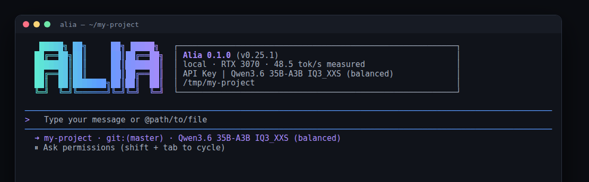
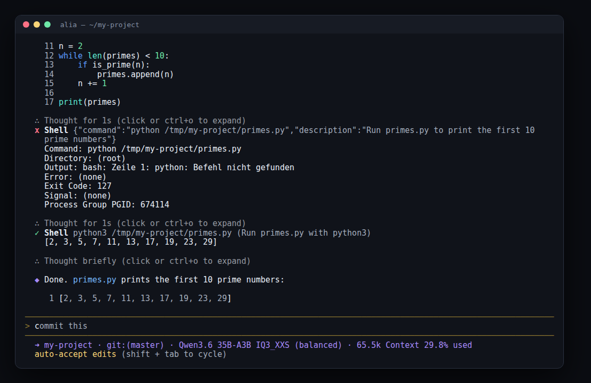
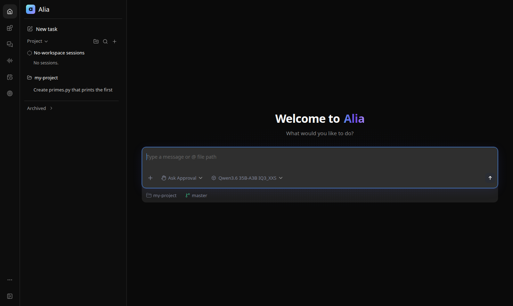

<p align="center"></p>

<p align="center"><b>Deine Hardware. Deine KI. Keine Cloud.</b><br><a href="README.md">English</a> | Deutsch</p>
<p align="center">
  <a href="https://github.com/BEKO2210/alia/actions/workflows/ci.yml"></a>
  <a href="https://github.com/BEKO2210/alia/actions/workflows/codeql.yml"></a>
  <a href="https://codecov.io/gh/BEKO2210/alia"></a>
  <a href="LICENSE"></a>
  <a href="https://beko2210.github.io/alia/"></a>
</p>

Alia ist ein vollständig lokaler Coding-Agent-Starter ausschließlich für Linux. Er erkennt NVIDIA-GPU, VRAM und RAM, wählt ein Hardwareprofil, startet `llama-server` und öffnet Qwen Code im gebrandeten Terminal oder als Web Shell. Alia implementiert weder einen eigenen Agent-Loop noch eine Inferenz-Engine.








> **Gemessen auf RTX 3070 8 GB, Ryzen 7 5800X, 16 GB RAM — Startkonfiguration**
>
> Qwen3.6 35B-A3B IQ3_XXS (Standard, Kontext 65.536): **46,5 / 35,2 / 38,2 Tok/s** Ausgabe und 1.008 / 1.301 / 1.041 Tok/s Prompt-Verarbeitung bei 4K / 32K / 60K (der 60K-Wert stammt aus einem früheren Lauf mit denselben Flags ohne `--jinja`, das nur die Chat-Vorlage wählt). Das 4K-Tempo ist stabil (46,5–49,7 Tok/s über drei Läufe). Das Tempo bei langem Kontext hängt am freien RAM: Verdrängen andere Programme das 13-GB-Modell aus dem Page-Cache, wird es von der SSD gestreamt und fällt auf 24,6 Tok/s bei 32K und 9,7 bei 60K (Lauf `llamacpp-20261015-101143`). **Für lange Kontexte 32 GB RAM nutzen** oder den Browser schließen. Alia warnt beim Start, wenn weniger als 11 GB RAM verfügbar sind, und `alia doctor` zeigt den freien RAM.
>
> Qwen3.5 9B Q4_K_M (schnell, Kontext 65.536): **65,7 / 57,5 / 50,2 Tok/s** Ausgabe und 2.978 / 2.708 / 2.423 Tok/s Prompt-Verarbeitung bei 4K / 32K / 60K.

TG ist die Token-Generierungsrate, PP die Prompt-Verarbeitungsrate. MTP bedeutet Multi-Token Prediction, also spekulative Decodierung über die MTP-Köpfe des Modells. Exakter Lauf und Kontext stehen für jede numerische Metrik direkt in `profiles.json`.
Die Qualitätswerte (35B: Code 9/10, Tools 7/8, JSON 3/3 mit Schema und 3/3 nur per Prompt; 9B: Code 8/10, Tools 8/8) stammen aus separaten Qualitätsläufen ohne aufgezeichneten Serverkontext und ohne Serverargumente; der 9B-Qualitätslauf lief über Ollama.

## Unterstützte Plattform und Voraussetzungen

Alia v0.1.0 unterstützt natives Linux mit NVIDIA-GPU. Es verwendet `/proc`, `flock` und den Linux-Prozessstartzeitpunkt; Windows, macOS, AMD-GPUs, reiner CPU-Betrieb und WSL2 werden nicht unterstützt. Python 3.12+ ist die unterstützte Laufzeit für das in diesem Release getestete Prozessmanagement.

Die exakte Qwen-Code-Version und das Hugging-Face-CLI installieren:

```bash
npm install -g @qwen-code/qwen-code@0.25.1
python3 -m pip install -U "huggingface_hub[cli]"
```

Einen CUDA-fähigen `llama-server` bauen. Commit `a0e6dc7` ist die von Alia minimal unterstützte und vermessene llama.cpp-Revision und enthält `--spec-type draft-mtp`:

```bash
git clone https://github.com/ggml-org/llama.cpp.git ~/src/llama.cpp
cd ~/src/llama.cpp
git checkout a0e6dc7
cmake -S . -B build -DGGML_CUDA=ON -DCMAKE_BUILD_TYPE=Release
cmake --build build --config Release -j"$(nproc)" --target llama-server
```

Erforderlich sind ein funktionierender NVIDIA-Treiber, ein von llama.cpp unterstütztes CUDA-Toolkit, CMake, C++-Compiler, Git, Node.js/npm sowie Python/pip. Der vermessene Build nutzte CUDA 12.8 auf einer RTX 3070. Alia sucht `~/src/llama.cpp/build/bin/llama-server`; für einen anderen getesteten Build kann `ALIA_LLAMA_SERVER=/absoluter/pfad/zu/llama-server` gesetzt werden. Der frühere Fallback auf Ollamas mitgeliefertes Binary wurde entfernt, weil dessen Flags und MTP-Unterstützung keine stabile öffentliche Schnittstelle sind.

Die Modell-Repositories sind öffentlich und benötigen normalerweise keine Hugging-Face-Anmeldung. Falls Hugging Face Authentifizierung verlangt oder ein Rate-Limit greift, vorher `hf auth login` ausführen.

## Installation

```bash
git clone https://github.com/BEKO2210/alia alia
cd alia
./install.sh
alia doctor
```

`install.sh` prüft Python 3.12+, Qwen Code 0.25.1, `hf` und `llama-server` und erzeugt danach `~/.local/bin/alia`. Bei jedem fehlgeschlagenen Dateisystemschritt bricht es ab. Falls nötig, das Verzeichnis zu `PATH` hinzufügen:

```bash
export PATH="$HOME/.local/bin:$PATH"
```

## Downloads und Speicherplatz

Der erste Start zeigt den exakten `hf download`-Befehl und fragt `Jetzt herunterladen? [y/N]`; ohne Bestätigung wird nichts geladen. Etwa 10 % freien Zusatzplatz über der Dateigröße einplanen:

| Profil/Modell | Download | Empfohlener freier Platz | Ca. bei 100 Mbit/s |
|---|---:|---:|---:|
| 35B IQ3_XXS, Standard | 14,07 GB | 16 GB | 19 Minuten |
| 9B Q4_K_M, schnell | 5,7 GB | 7 GB | 8 Minuten |
| 35B Q4_K_XL, unvermessen | 20,8 GB | 23 GB | 28 Minuten |

Die tatsächliche Dauer hängt von Hugging Face und der Verbindung ab. Eine nach Abbruch zu kleine GGUF-Datei wird beim nächsten Start abgelehnt. Downloads landen unter `~/.local/share/alia/models`. Ein dokumentierter generischer Kandidat wie `~/models/gguf/Qwen3.5-9B-Q4_K_M.gguf` verhindert einen zweiten Download.

## Verwendung

```bash
alia                              # Hardware erkennen, Server und Agent starten
alia --lang de_DE.UTF-8           # Sprache für diesen Aufruf setzen
alia --fast                       # Denken für einfache, schnelle Aufgabe aus
alia --wait-gpu 60                # auf optionale gemeinsame GPU-Sperre warten
alia --auto-edit                  # Dateiänderungen automatisch erlauben
alia --yolo                       # alle Tools erlauben; rote Warnung
alia -- -p "Erkläre main.py"      # Argumente unverändert an qwen geben
alia web                          # Web Shell auf 127.0.0.1:4170
alia web --port 4317 --no-open --workspace "$PWD"
alia doctor                       # prüft auch Modell, hf, Speicher und Port
alia profiles
alia use rtx8gb-qwen35-9b-fast
alia use auto
alia lang de_DE.UTF-8             # Deutsch dauerhaft; Locale-Formen gehen
alia lang en
alia lang auto
alia logs
alia stop
alia --help
alia --version
```

Sprachvorrang: `--lang` → `ALIA_LANG` → Konfiguration → `LC_ALL` → `LC_MESSAGES` → `LANG` → Englisch. Modellantworten folgen der Eingabesprache, sofern keine andere Sprache ausdrücklich verlangt wird.

`--fast` schreibt `chat_template_kwargs.enable_thinking: false`; normale Läufe lassen Denken aktiviert. Im Standardmodus wird vor Änderungen und Befehlen gefragt. `--auto-edit` genehmigt nur Änderungen. `--yolo` genehmigt alle Tool-Aufrufe und gehört nur in vollständig vertrauenswürdige Workspaces.

Zur Koordination mit anderen GPU-Jobs kann `gpu_lock` in `~/.config/alia/config.json` oder `ALIA_GPU_LOCK` auf eine Sperrdatei zeigen. `--wait-gpu S` begrenzt die Wartezeit. Zusätzlich hält Alia immer eine eigene Statussperre über Wiederverwendungsprüfung, Start und Gesundheitsprüfung.

```json
{"gpu_lock": "~/.cache/shared-gpu.lock"}
```

Laufzeitdaten liegen unter `~/.local/state/alia`, Modelle unter `~/.local/share/alia/models`, Einstellungen unter `~/.config/alia/config.json`. Qwen nutzt ein isoliertes Alia-`QWEN_HOME`.

## Mitgelieferte Profile

| Profil | Ziel | Modell/Download | TG 4K / 32K | PP 4K / 32K | Status |
|---|---|---|---:|---:|---|
| `rtx8gb-16gb-qwen36-35b` | 8 GB VRAM, 16 GB RAM | 35B IQ3_XXS, 14,07 GB | 46,5 / 35,2 | 1.008 / 1.301 | gemessen, Startkonfiguration; 32K braucht freien RAM |
| `rtx8gb-qwen35-9b-fast` | 8 GB VRAM, 12 GB RAM | 9B Q4_K_M, 5,7 GB | 65,7 / 57,5 | 2.978 / 2.708 | gemessen, Startkonfiguration |
| `rtx12-16gb-qwen36-35b-q4` | 12–16 GB VRAM, 32 GB RAM | 35B Q4_K_XL, 20,8 GB | — | — | unvermessen; nie auf Zielhardware gelaufen |
| `rtx24gb-qwen36-35b-q4` | ab 20 GB VRAM, 32 GB RAM | 35B Q4_K_XL, 20,8 GB | — | — | unvermessen; nie auf Zielhardware gelaufen |

Die automatische Auswahl bevorzugt das höchstrangige passende vermessene Profil und warnt vor einem unvermessenen oder unpassend fixierten Profil. Messmethodik und Grenzen stehen in [`bench/REPORT.md`](bench/REPORT.md), die Rohdatenübersicht in [`bench/results/README.md`](bench/results/README.md), das unabhängige Review in [`bench/reviews/grok-bench-review.md`](bench/reviews/grok-bench-review.md).

## Profil hinzufügen

Ein Objekt zu `profiles.json` hinzufügen. Nur generische `~/models/...`-Kandidaten verwenden. Jede numerische Messmetrik braucht einen `metric_sources`-Eintrag mit `bench/results/*.jsonl`-Lauf und Serverkontext; Unterschiede bei Binary, Kontext oder Flags gegenüber der Startkonfiguration müssen genannt werden.

```bash
python3 -m json.tool profiles.json >/dev/null
python3 -m unittest discover -s tests -v
./alia profiles
```

## Sicherheit

Alia erzwingt für `llama-server` `127.0.0.1:8090`, lehnt Host-/Port-Overrides aus Profilen ab, deaktiviert die llama.cpp-Weboberfläche und übergibt den lokalen API-Schlüssel an Server und Qwen. Das Statusverzeichnis hat Modus `0700`, Status-, Settings-, Sperr- und Logdateien `0600`. Stoppsignale treffen nur die gespeicherte PID nach Prüfung ihrer Linux-Startzeit. Lebt der Prozess nach SIGKILL weiter, bleiben die Statusdateien erhalten. Alia verwendet nie `pkill`.

Loopback trennt keine gegenseitig unvertrauenswürdigen lokalen Benutzer. Der feste lokale API-Schlüssel ist für ausreichend privilegierte lokale Prozesse sichtbar; die Qwen Web Shell hat keine zusätzliche Bearer-Token-Sperre. Keinen Port über SSH-Forwarding, Reverse Proxy, Container oder Firewalländerungen freigeben. Keine parallelen Alia-Sitzungen mit verschiedenen Freigabemodi starten, da sie eine Settings-Datei teilen. `--yolo` erlaubt beliebige Tools ohne Rückfrage. Ollama-Unload spricht nur Ollamas Loopback-API an: ein nicht laufendes Ollama wird ignoriert, aber Alia bricht ab, wenn erkannte Modelle nicht binnen 10 Sekunden entladen sind.

## Showcase

[Alia, von Alia erklärt](https://beko2210.github.io/alia/showcase/architecture/) ist eine Seite, die Alia lokal auf der RTX 3070 über die eigene Architektur geschrieben hat: Es hat den eigenen Quellcode gelesen und das interaktive Diagramm, den animierten Request-Flow und den Benchmark-Teil gebaut. [Alle Prompts](site/showcase/architecture/PROMPTS.md) sind veröffentlicht, auch das, was schiefging.

## Entwicklung und Screenshots

Die Unit-Tests brauchen keine GPU, starten keinen Server und laden keine Modelle:

```bash
python3 -m unittest discover -s tests -v
```

`tools/screenshot.sh` ist nur für Entwicklung und benötigt zusätzlich tmux sowie Chrome/Chromium. Es liest ein vorhandenes Pane und startet weder Alia noch tmux.

## Danksagung und Lizenzen

- [Qwen Code](https://github.com/QwenLM/qwen-code), Apache-2.0
- [llama.cpp](https://github.com/ggml-org/llama.cpp), MIT
- Qwen-Modelle und GGUF-Repositories unter ihren jeweiligen Lizenzen

Siehe [`LICENSE`](LICENSE) und [`NOTICE`](NOTICE). Alia startet externe Komponenten, verteilt sie aber nicht weiter.
